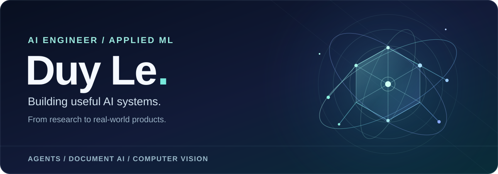

I build AI systems that turn research and real-world data into products people can use. My work spans **LLM agents, document understanding, computer vision and the engineering around them**—from data pipelines and evaluation to APIs and interfaces.

[Portfolio](https://duyle.me) · [LinkedIn](https://www.linkedin.com/in/leduy-it/) · Ho Chi Minh City, Vietnam

## At a glance

| What I work on | From idea to delivery |
| :--- | :--- |
| **AI & ML** | LLM applications, agents, OCR, computer vision and evaluation |
| **Systems** | Python, data pipelines, APIs and automation |
| **Products** | Practical workflows, developer tools and web interfaces |

## Experience

| Organization | Focus |
| :--- | :--- |
| **GrowtricsAI** | Learning workflows, agents and automation |
| **GMO-Z.com RUNSYSTEM** | Multilingual OCR and document understanding |
| **SmartPay** | Applied AI for fraud-related workflows |

More about my background and work on [my portfolio](https://duyle.me).

## Selected work

[Agent Framework Crash-Resume Benchmark](https://github.com/leduy-it/agent-framework-resume-benchmark) · A practical look at what agent frameworks replay after a crash.

[Hatch Pet Plus](https://github.com/leduy-it/hatch-pet-plus) · A creative toolkit for building animated pets for Codex and Claude Code.

---

I value thoughtful engineering, clear measurement and sharing what I learn.
